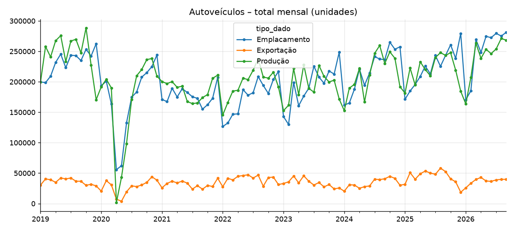
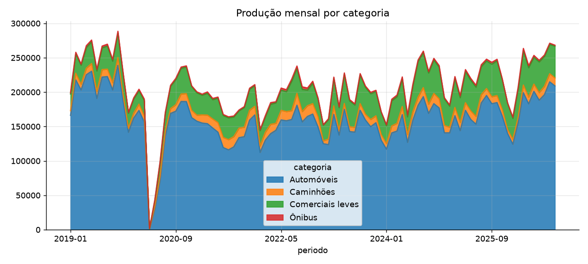
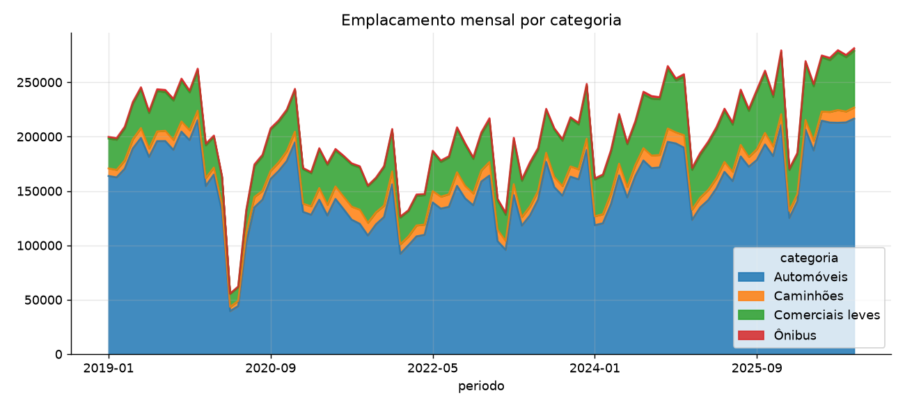
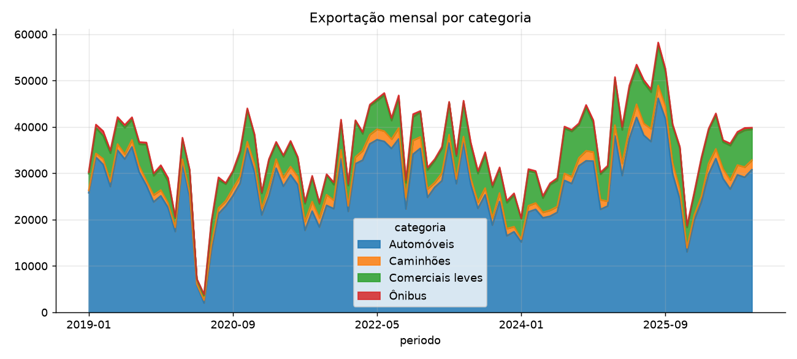
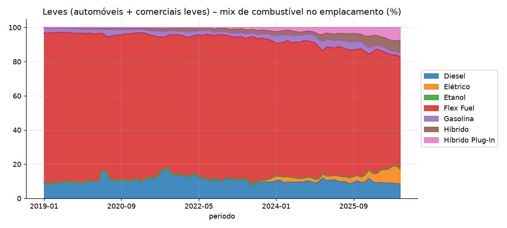
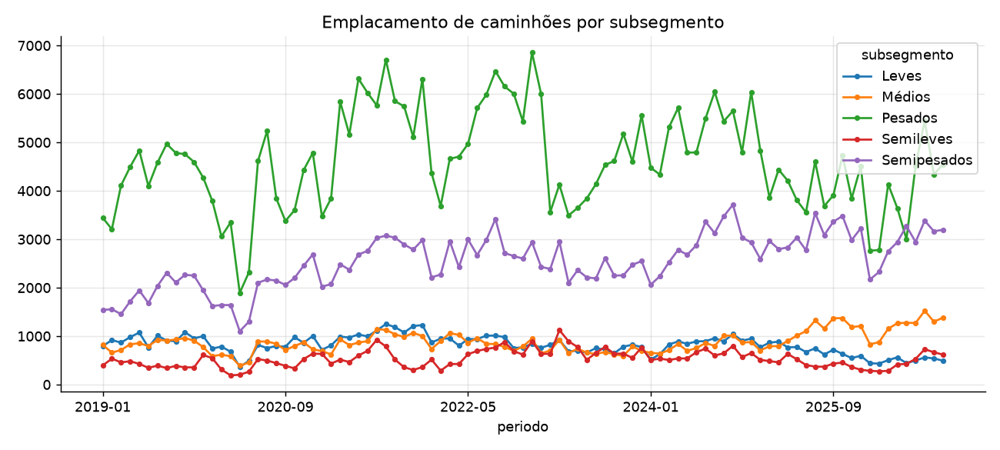
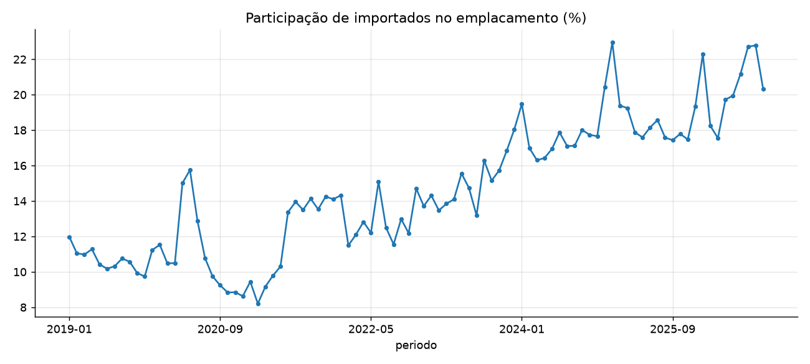
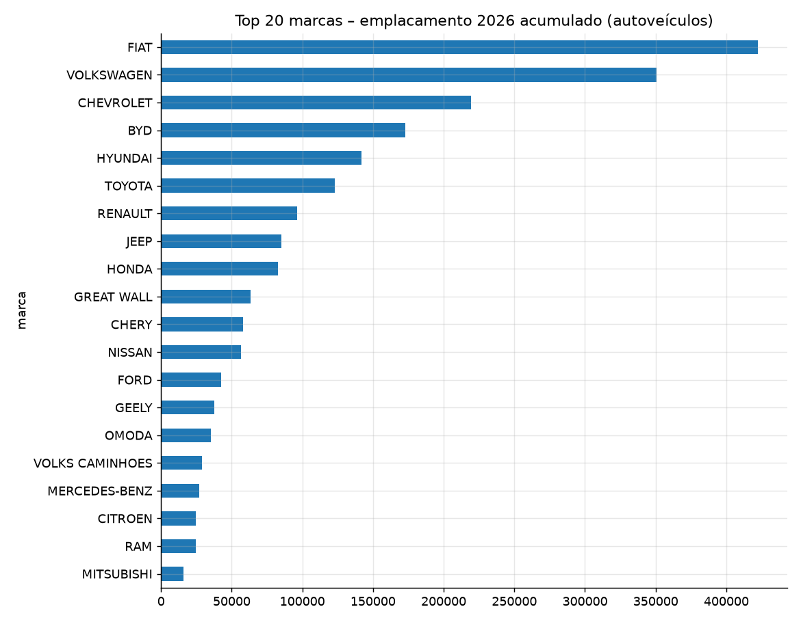

# ANFAVEA – Autoveículos: relatório 01/2019 a 09/2026

Fonte: [ANFAVEA – Central de Dados](https://anfavea.com.br/site/central-de-dados/). Coletado em 2026-10-29. Unidades. Planilha completa: [relatorio_anfavea_autoveiculos.xlsx](relatorio_anfavea_autoveiculos.xlsx); base longa: [base_autoveiculos.csv](base_autoveiculos.csv).

## Totais anuais

| Indicador | 2019 | 2020 | 2021 | 2022 | 2023 | 2024 | 2025 | 2026 (jan-09) |
|---|---:|---:|---:|---:|---:|---:|---:|---:|
| Produção | 2.944.988 | 2.014.055 | 2.248.253 | 2.369.769 | 2.324.838 | 2.553.869 | 2.644.054 | 2.165.787 |
| Emplacamento | 2.787.850 | 2.058.437 | 2.119.851 | 2.104.461 | 2.308.689 | 2.634.904 | 2.689.634 | 2.256.702 |
| Exportação | 433.512 | 324.330 | 376.383 | 480.929 | 403.919 | 400.238 | 528.827 | 333.953 |

## Acumulado jan–09: 2026 vs 2025

| Indicador | Categoria | 2025 | 2026 | Var. |
|---|---|---:|---:|---:|
| Produção | Automóveis | 1.500.375 | 1.670.915 | +11,4% |
| Produção | Comerciais leves | 369.715 | 381.224 | +3,1% |
| Produção | Caminhões | 98.632 | 92.305 | -6,4% |
| Produção | Ônibus | 24.030 | 21.343 | -11,2% |
| Produção | **Total** | 1.992.752 | 2.165.787 | +8,7% |
| Emplacamento | Automóveis | 1.411.629 | 1.729.542 | +22,5% |
| Emplacamento | Comerciais leves | 397.569 | 429.365 | +8,0% |
| Emplacamento | Caminhões | 84.049 | 80.882 | -3,8% |
| Emplacamento | Ônibus | 17.690 | 16.913 | -4,4% |
| Emplacamento | **Total** | 1.910.937 | 2.256.702 | +18,1% |
| Exportação | Automóveis | 333.034 | 251.587 | -24,5% |
| Exportação | Comerciais leves | 73.895 | 61.802 | -16,4% |
| Exportação | Caminhões | 21.639 | 17.036 | -21,3% |
| Exportação | Ônibus | 5.233 | 3.528 | -32,6% |
| Exportação | **Total** | 433.801 | 333.953 | -23,0% |

## Último mês (09/2026)

| Indicador | Mês | Mesmo mês ano anterior | Var. |
|---|---:|---:|---:|
| Produção | 268.269 | 243.393 | +10,2% |
| Emplacamento | 281.361 | 243.230 | +15,7% |
| Exportação | 39.843 | 52.544 | -24,2% |

## Emplacamento por combustível (leves)

| Combustível | 2019 | 2020 | 2021 | 2022 | 2023 | 2024 | 2025 | 2026 |
|---|---:|---:|---:|---:|---:|---:|---:|---:|
| Flex Fuel | 87,4% | 85,2% | 82,2% | 83,3% | 83,0% | 79,1% | 74,4% | 68,0% |
| Diesel | 9,4% | 10,8% | 13,4% | 11,7% | 9,9% | 9,7% | 10,0% | 9,2% |
| Elétrico | 0,0% | 0,0% | 0,1% | 0,4% | 0,9% | 2,5% | 3,1% | 7,7% |
| Híbrido Plug-In | 0,1% | 0,3% | 0,6% | 0,5% | 1,5% | 2,5% | 3,9% | 6,4% |
| Híbrido | 0,4% | 0,8% | 1,1% | 1,6% | 2,0% | 2,1% | 4,2% | 6,0% |
| Gasolina | 2,8% | 2,9% | 2,6% | 2,4% | 2,7% | 4,1% | 4,5% | 2,6% |
| Etanol | 0,0% | 0,0% | 0,0% | 0,0% | 0,0% | 0,0% | 0,0% | 0,1% |

## Caminhões por subsegmento (emplacamento)

## Nacionais x importados (emplacamento)

| Ano | Nacional | Importado | % importado |
|---|---:|---:|---:|
| 2019 | 2.490.193 | 297.657 | 10,7% |
| 2020 | 1.846.818 | 211.619 | 10,3% |
| 2021 | 1.866.073 | 253.778 | 12,0% |
| 2022 | 1.830.992 | 273.469 | 13,0% |
| 2023 | 1.956.700 | 351.989 | 15,2% |
| 2024 | 2.168.399 | 466.505 | 17,7% |
| 2025 | 2.191.869 | 497.765 | 18,5% |
| 2026 | 1.792.761 | 463.941 | 20,6% |

## Emplacamento por empresa – 2026 acumulado (desde 01/2026)

> A ANFAVEA só publica empresa/marca a partir de jan/2026.

| # | Empresa | Nacional | Importado | Total | Part. |
|---:|---|---:|---:|---:|---:|
| 1 | FCA FIAT CHRYSLER | 498.126 | 41.031 | 539.157 | 23,9% |
| 2 | VOLKSWAGEN | 329.838 | 20.854 | 350.692 | 15,5% |
| 3 | OUTRAS EMPRESAS | 105.698 | 207.845 | 313.543 | 13,9% |
| 4 | GENERAL MOTORS | 209.855 | 15.259 | 225.114 | 10,0% |
| 5 | HYUNDAI | 141.086 | 693 | 141.779 | 6,3% |
| 6 | RENAULT | 93.389 | 40.865 | 134.254 | 5,9% |
| 7 | TOYOTA | 75.349 | 48.507 | 123.856 | 5,5% |
| 8 | HONDA | 82.337 | 328 | 82.665 | 3,7% |
| 9 | CAOA | 62.332 | 3.272 | 65.604 | 2,9% |
| 10 | NISSAN | 49.620 | 6.976 | 56.596 | 2,5% |
| 11 | FORD | 124 | 42.176 | 42.300 | 1,9% |
| 12 | PEUGEOT CITROEN | 23.342 | 13.927 | 37.269 | 1,7% |
| 13 | VOLKSWAGEN TRUCK & BUS | 28.946 | 0 | 28.946 | 1,3% |
| 14 | MERCEDES-BENZ | 27.013 | 7 | 27.020 | 1,2% |
| 15 | HPE | 15.160 | 988 | 16.148 | 0,7% |
| 16 | VOLVO | 14.466 | 27 | 14.493 | 0,6% |
| 17 | IVG | 12.724 | 4 | 12.728 | 0,6% |
| 18 | BMW | 6.566 | 5.290 | 11.856 | 0,5% |
| 19 | MERCEDES-BENZ CARS & VANS | 0 | 11.544 | 11.544 | 0,5% |
| 20 | SCANIA | 8.997 | 47 | 9.044 | 0,4% |
| 21 | DAF | 4.649 | 1 | 4.650 | 0,2% |
| 22 | AUDI | 159 | 2.950 | 3.109 | 0,1% |
| 23 | AGRALE | 2.469 | 0 | 2.469 | 0,1% |
| 24 | JAGUAR LAND ROVER | 516 | 1.350 | 1.866 | 0,1% |

## Metodologia e limitações

- Dados obtidos da mesma API que alimenta a Central de Dados (`admin-ajax.php`, `action=anfavea_dashboard1`), agregação mensal.
- Emplacamento: Renavam/Senatran. Produção a partir de 2026 inclui empresas não associadas (volume estimado pela ANFAVEA).
- Empresa/marca: tabela de origem só tem dados desde 2026-01 (limitação da ANFAVEA).
- Subsegmentos de caminhões não estão disponíveis cruzados com combustível.
- Colunas TOTAL da ANFAVEA foram descartadas e os totais recalculados.
- Conferência: as aberturas por procedência, empresa e marca somam exatamente o total por categoria; por combustível e por subsegmento de caminhões há diferenças pontuais de poucas unidades em alguns meses, vindas da própria fonte.
